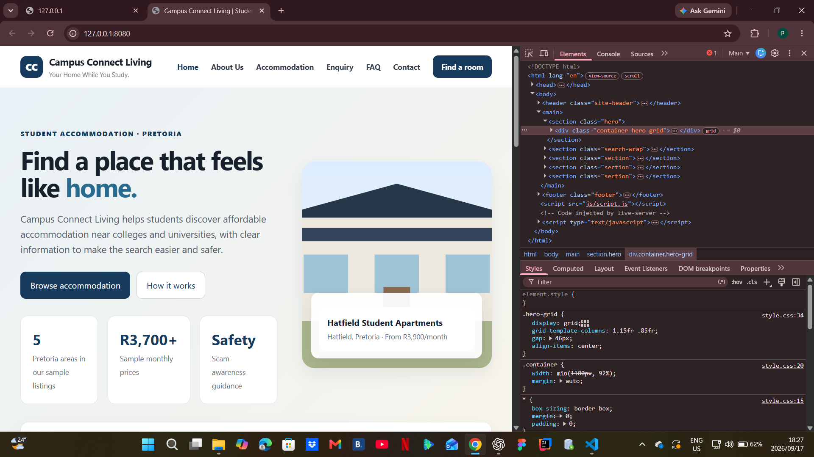
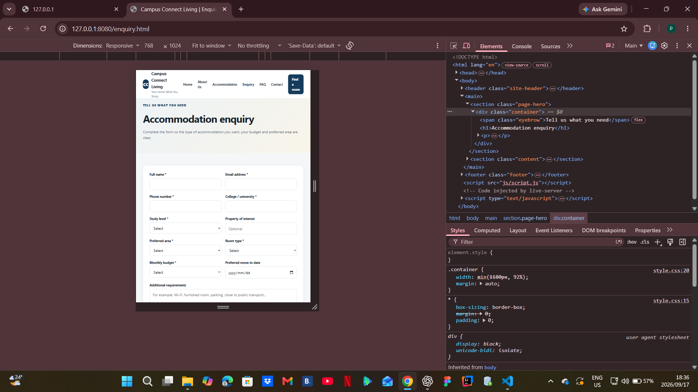
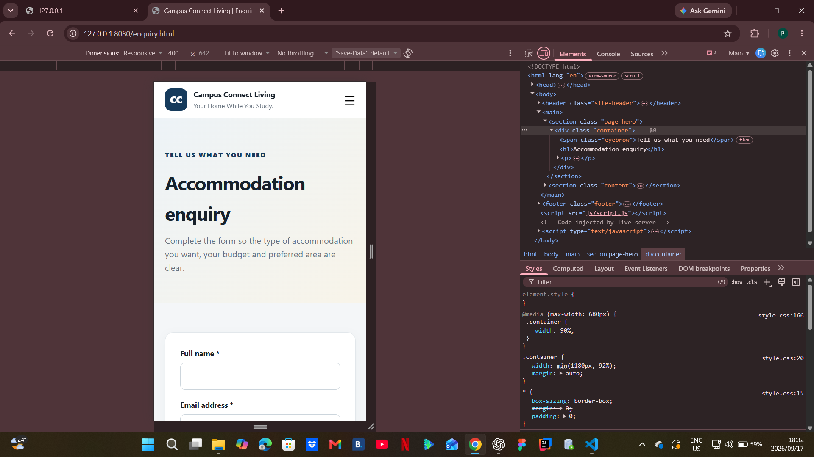

# Campus Connect Living

## Student / Module
- **Module:** WEDE5020 - Web Development (Introduction)
- **Year:** 2026
- **Project type:** Academic student accommodation website prototype

## Project Overview
Campus Connect Living is a fictional student accommodation platform concept focused on Pretoria. The prototype helps students explore sample accommodation options and understand the information they should check before choosing a property.

## Goals and Objectives
- Present accommodation information clearly.
- Help students filter sample listings by area, room type, budget and keyword.
- Provide simple enquiry and contact pathways.
- Use a consistent visual identity across all pages.
- Make the interface usable on desktop, tablet and mobile screens.

## Target Audience
The primary audience is college and university students looking for accommodation in Pretoria, with parents/guardians as a secondary audience.

## Technologies Used
- HTML5
- CSS3
- JavaScript
- System font stack (Inter/Segoe UI/Arial fallbacks)
- Unsplash photographs used as representative accommodation imagery

## Pages
1. `index.html` - Home page and accommodation search
2. `about.html` - About the project and student safety information
3. `accommodation.html` - Search and filter sample listings
4. `enquiry.html` - Accommodation enquiry form
5. `faq.html` - Frequently asked questions
6. `contact.html` - Contact information and contact form

## Folder Structure
```text
CampusConnectLiving1/
|-- index.html
|-- about.html
|-- accommodation.html
|-- enquiry.html
|-- faq.html
|-- contact.html
|-- css/
|   |-- style.css
|-- js/
|   |-- script.js
|-- images/
|   |-- properties/
|   |   |-- rwd/        # responsive local image variants retained for project assets
|   |-- Testing/        # Part 2 responsive testing screenshots
|-- README.md
```

## Part 2 CSS Implementation
The shared `css/style.css` file is linked to every HTML page. The stylesheet includes:
- CSS reset and base/default styling.
- A consistent colour palette using CSS custom properties.
- Typography using `rem`, `em`, percentages and `clamp()` where appropriate.
- CSS Grid and Flexbox for page, card, form and footer layouts.
- Borders, rounded corners, shadows and visual hierarchy.
- `:hover`, `:focus-visible` and `:active` states for interactive elements.
- Tablet and mobile media queries.
- Responsive navigation that changes to a menu button on small screens.
- Responsive images using `srcset`, `sizes`, `max-width: 100%` and `object-fit`.

## Responsive Breakpoints
- **Desktop:** default layout for larger screens.
- **Tablet:** `max-width: 900px` changes major grids to fewer columns.
- **Mobile:** `max-width: 680px` uses single-column cards/forms and collapses navigation.

The responsive layout was tested using Chrome DevTools device emulation.

## Responsive Testing Evidence

### Desktop
The desktop layout was checked in the normal browser view. The navigation is displayed horizontally and the homepage uses the larger multi-column hero/card layout.



### Tablet
The tablet layout was tested at **768 × 1024** in Chrome DevTools. The main grids reduce their column count while the content remains readable.



### Mobile
The mobile layout was tested at **400 × 642** in Chrome DevTools. The navigation collapses to a hamburger menu and the main content/forms use a single-column layout.



### Testing checks
- Navigation changes appropriately between desktop and mobile.
- Content does not intentionally extend beyond the viewport.
- Accommodation cards change from multiple columns to fewer columns and then one column.
- Forms change from two columns to one column on mobile.
- Images scale within their containers.
- Typography and spacing are adjusted at the responsive breakpoints.
- Interactive controls were checked at the tested viewport sizes.

## JavaScript Prototype Features
The existing JavaScript supports:
- Mobile navigation toggle with `aria-expanded` state.
- Home-page accommodation search.
- Accommodation filtering.
- Property detail modal.
- FAQ accordion with expanded-state accessibility.
- Demo form submission feedback.

These are prototype interactions and do not create real bookings, payments or server-side submissions.

## Part 1 Feedback Implemented
The Part 1 feedback identified the following areas for improvement:

| Part 1 feedback area | Part 2 response |
|---|---|
| Content research and sourcing needed more detail and better references. | Added clearer project/source documentation and a dedicated image-sourcing section; sample listing information is explicitly identified as prototype content. |
| HTML layout tags had significant errors/omissions. | Reviewed the six pages for consistent semantic `header`, `nav`, `main` and `footer` structure and improved navigation accessibility. |
| HTML content tags needed improvement. | Reviewed headings, paragraphs, lists, links, forms and form labels; enquiry/contact inputs use associated labels. |
| Code comments did not fully explain the code. | Added comments to the shared CSS and JavaScript to explain major sections and functions. |
| README was incomplete. | Expanded the README with Part 2 implementation details, breakpoints, testing evidence, feedback work and image sourcing. |
| Changelog needed more detail. | Added detailed Part 2 entries explaining the changes and the criteria addressed. |
| References were incomplete/incorrect. | Expanded the reference list and documented the accommodation image sources used. |
| GitHub commits needed to remain descriptive. | Part 2 changes should be committed using descriptive messages that identify the change made. |

## Changelog
| Date | Change | Reason / criterion addressed |
|---|---|---|
| 2026-07-28 | Initial project structure and HTML pages created. | Part 1 project setup. |
| 2026-08-10 | Expanded content, navigation and documentation. | Part 1 feedback and content requirements. |
| 2026-09-13 | Reviewed all six HTML pages and confirmed the shared external stylesheet is linked throughout. | Part 2: External stylesheet. |
| 2026-09-13 | Strengthened base CSS, typography, layout grids, cards, forms and visual hierarchy. | Part 2: Default styling, typography, layout and decoration. |
| 2026-09-13 | Added explicit hover, focus-visible and active interaction states. | Part 2: Pseudo-classes. |
| 2026-09-13 | Refined tablet and mobile breakpoints, including single-column layouts and mobile navigation. | Part 2: Responsive design. |
| 2026-09-13 | Added accessibility attributes to the mobile navigation and improved keyboard focus styling. | Responsive navigation and usability. |
| 2026-09-13 | Removed unnecessary inline presentation styles and moved presentation rules into the external stylesheet. | Consistency and maintainability. |
| 2026-09-17 | Added explanatory comments across the shared stylesheet and JavaScript and improved FAQ/navigation accessibility states. | Part 1 feedback: code comments; Part 2 usability. |
| 2026-09-17 | Recorded desktop, tablet and mobile responsive testing evidence and added the screenshots to the README. | Part 2: Test and iterate; screenshot evidence. |
| 2026-09-17 | Updated image-source documentation and clarified that property data and accommodation details are fictional/sample project data. | Part 2: References and accurate content sourcing. |

## References
- Mozilla Developer Network. (n.d.). *CSS media queries*. Available at: https://developer.mozilla.org/en-US/docs/Web/CSS/CSS_media_queries (Accessed 17 September 2026).
- Mozilla Developer Network. (n.d.). *CSS Grid Layout*. Available at: https://developer.mozilla.org/en-US/docs/Web/CSS/CSS_grid_layout (Accessed 17 September 2026).
- Mozilla Developer Network. (n.d.). *Using the viewport meta element*. Available at: https://developer.mozilla.org/en-US/docs/Web/HTML/Guides/Viewport_meta_element (Accessed 17 September 2026).
- W3Schools. (n.d.). *CSS Responsive Web Design*. Available at: https://www.w3schools.com/css/css_rwd_intro.asp (Accessed 17 September 2026).

### Image sourcing
The accommodation cards use representative photographs from Unsplash. The property names, prices, locations and availability details remain fictional/sample content for the POE prototype.

Unsplash states that its published photos can be used for free under the Unsplash License. The individual image pages used in this project are listed below for traceability:
- Bailey Alexander, bedroom/interior photograph: https://unsplash.com/photos/a-bedroom-with-a-bed-nightstand-and-two-windows-K0JMu3u8omg
- Lisa Anna, bedroom with desk: https://unsplash.com/photos/a-bedroom-with-a-bed-and-a-desk-xMX8EOYLOG0
- Lisa Anna, bedroom with skylight: https://unsplash.com/photos/a-bedroom-with-a-bed-and-a-skylight-IptnKrssVY4
- Alvin David, house exterior: https://unsplash.com/photos/a-house-exterior-bathed-in-warm-golden-sunset-light-dpMuwf_oDD4
- Hannah Busing, living room: https://unsplash.com/photos/photo-of-living-room-U-k6XLlml1I
- Unsplash. (n.d.). *License*. https://unsplash.com/license

Accessed September 2026.

## AI Use / Academic Disclosure
AI assistance was used during development to support code review, responsive CSS/HTML improvements, documentation and troubleshooting. The student remains responsible for checking, understanding and testing the submitted work.

The final submission should include the required AI disclosure annexure/screenshots specified by the IIE assessment guidelines. Any AI-generated or AI-assisted material used in the final submission should be referenced according to the module's required referencing format.

## Academic / Prototype Notice
Property names, prices, contact details and accommodation availability are sample academic-project data. The website does not represent verified real accommodation listings, booking guarantees or payment instructions.


## Part 3: Enhancing Functionality and SEO (2026-10-28)

### Functionality and forms
- Retained the accommodation search, filtering, property details modal, responsive navigation, and FAQ accordion interactions.
- Improved FAQ button `aria-expanded` state for assistive technology.
- Updated the enquiry and contact demo forms to validate required fields and prepare an email draft addressed to the project contact. The visitor must review and send the email; this static website does not submit to a server or send messages automatically.
- Accommodation listings and pricing are fictional academic sample data and do not represent real-time availability.

### SEO updates
- Added page-specific title tags and meta descriptions for all six HTML pages.
- Added robots indexing directives and created `robots.txt` and `sitemap.xml`.
- **Before publishing:** replace `https://YOUR-DEPLOYED-DOMAIN.example` in both SEO files with the real deployed domain. Do not submit the placeholder URLs to search engines.
- Existing image alt text is retained for dynamically generated accommodation cards. Verify all images and alt text during final review.

### Part 3 test checklist
- [ ] Open all six pages and confirm they load without missing assets.
- [ ] Test navigation at desktop and mobile widths.
- [ ] Test home-page area/budget search and accommodation keyword/area/type/budget filters, including Clear filters and no-results message.
- [ ] Open and close property details with the close button and Escape key.
- [ ] Expand/collapse FAQ answers and confirm the expanded state changes.
- [ ] Submit invalid form data and confirm browser validation appears.
- [ ] Submit valid contact and enquiry forms; confirm an email draft opens, then cancel it if you do not intend to send a real message.
- [ ] Check all page titles, meta descriptions, internal links, keyboard focus, images, and mobile layout.
- [ ] Replace the sitemap/robots placeholder domain after deployment.
- [ ] Validate HTML/CSS, inspect the browser console, and record actual test results/screenshots.

### Part 3 changelog
| Date | Change | Purpose |
|---|---|---|
| 2026-10-28 | Added unique titles and meta descriptions to all six pages. | Page-level SEO. |
| 2026-10-28 | Added robots.txt and sitemap.xml templates. | Search-engine discovery; live domain must be inserted before deployment. |
| 2026-10-28 | Improved FAQ expanded-state accessibility. | JavaScript interaction and accessibility. |
| 2026-10-28 | Improved contact and enquiry validation and email-draft preparation. | Form feedback and user workflow; no backend submission. |
| 2026-10-28 | Added Part 3 test checklist and documentation. | Testing and maintainability. |

### Deployment and academic honesty note
This archive has not been deployed, pushed to a remote GitHub repository, or independently browser-tested as a live site. Perform the checklist above, replace the domain placeholders, and record only tests you actually complete.


## Part 3 audit and preserved source files

This update is based on the supplied CampusConnect2 project. Existing page content, the CC text mark, styles, property image assets, responsive screenshots, and existing property-search/detail interactions were retained. No new logo was required by the Part 3 brief, so the existing CC brand mark was not replaced.

### Additional corrections in this audit
- Contact form now asks for a message type and full message, with HTML constraints and a clear email-draft hand-off.
- Accommodation enquiry uses required contact and accommodation preferences, a phone-format constraint, and property prefill from listing links. It displays a response clarifying that availability is sample-only and unconfirmed.
- Added an image lightbox for the dynamically rendered property photos, with close button, backdrop click, and Escape support.
- Added reduced-motion handling and focus styling.
- Reviewed page-specific titles and meta descriptions across all six HTML pages.
- Kept the original property images in `images/properties/`; property card photographs referenced by the existing JavaScript are remote illustrative images and require internet access.

### Known limits / actions before submission
- Forms use `mailto:` and open the visitor's configured email application; they do not submit to a backend or send automatically. A real server/AJAX endpoint would require a configured service.
- Property data is fictional sample project data; do not describe it as real-time availability.
- Replace the placeholder domain in `robots.txt` and `sitemap.xml` after deployment.
- Off-page SEO (backlinks/social promotion) requires real external activity and cannot be completed solely by editing local HTML.
- Complete the test checklist and only mark tests as passed after actually testing them.
